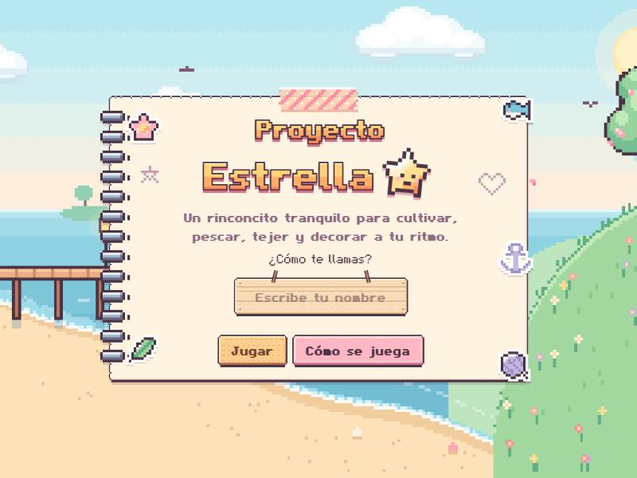
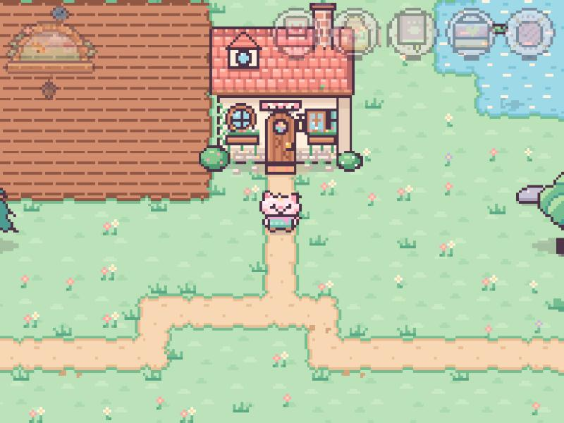

<div align="center">

# ⭐ Proyecto Estrella

**Un juego cozy en pixel art: una gatita rosa cultiva, pesca, teje ropa, construye muebles, decora su casa y ayuda a sus vecinos en un valle junto al mar.**
Sin prisas, sin castigos, a tu ritmo.

[](https://github.com/guess-samuel2401/proyecto-estrella/releases/latest)


[**⬇️ Descargar para Windows**](https://github.com/guess-samuel2401/proyecto-estrella/releases/latest/download/Proyecto-Estrella.exe) · [🎬 Ver el tráiler](https://github.com/guess-samuel2401/proyecto-estrella/releases/latest)

 

</div>

## ✨ Qué se puede hacer

| | |
|---|---|
| 🌱 **Cultivar** | 9 cultivos que se siembran, se riegan y crecen por etapas; el abono los adelanta. |
| 🎣 **Pescar** | 47 especies repartidas en estanques, lagos, el río, pozas de marea y mar abierto (en barca), con rarezas y versiones brillantes. |
| 🧶 **Tejer** | Ropa para la gatita, con 8 tintes para teñirla. |
| 🪑 **Construir y decorar** | 52 muebles para el interior y el jardín: bancas, fuentes, macetas, flores… |
| 🏡 **Elegir tu hogar** | Al empezar decides dónde va tu casita y tu huerto. |
| 🐾 **Ayudar a los vecinos** | Pedidos y regalos para los habitantes del valle, y una tienda en el valle. |
| 🌦️ **Clima y día/noche** | Lluvia, viento y noches que cambian el aspecto del valle. |

Todo el texto está en español, con un tono tierno y amable. La partida se guarda sola.

## 🎮 Controles

| Tecla | Acción |
|---|---|
| Flechas / WASD | Moverse |
| Mayús | Correr / patinar |
| Espacio / E | Actuar (regar, pescar, hablar, recoger…) |
| H | Ayuda |

## 🚀 Jugar

- **Windows:** descarga [`Proyecto-Estrella.exe`](https://github.com/guess-samuel2401/proyecto-estrella/releases/latest/download/Proyecto-Estrella.exe) y ábrelo. No hace falta instalar nada.
  Si Windows muestra «Windows protegió su PC», pulsa **Más información → Ejecutar de todas formas** (el programa no tiene firma digital comercial).
- **Navegador:** desde la carpeta del proyecto ejecuta `python -m http.server 8123` y abre <http://localhost:8123/juego/>.

## 🛠️ Cómo está hecho

- **Motor propio** en JavaScript puro sobre `<canvas>`, sin librerías ni frameworks.
- **Sonido sintetizado** en tiempo real con la Web Audio API (`juego/sonido.js`): no hay archivos de audio.
- **Arte generado por código:** cada sprite está dibujado como texto en `arte/fuentes/*.json` con una paleta común, y unos scripts lo convierten en PNG.
- **Escritorio con Electron**, empaquetado como un único `.exe` portable.

## 📁 Estructura

```
juego/        el juego (HTML + JavaScript, sonido con Web Audio)
arte/         paleta, diseños de sprites como texto y scripts que generan los PNG
escritorio/   empaquetado con Electron (npm install y npm run exe)
trailer/      script que graba el tráiler con gameplay real
docs/         capturas para este README
```
